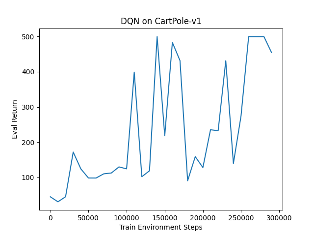
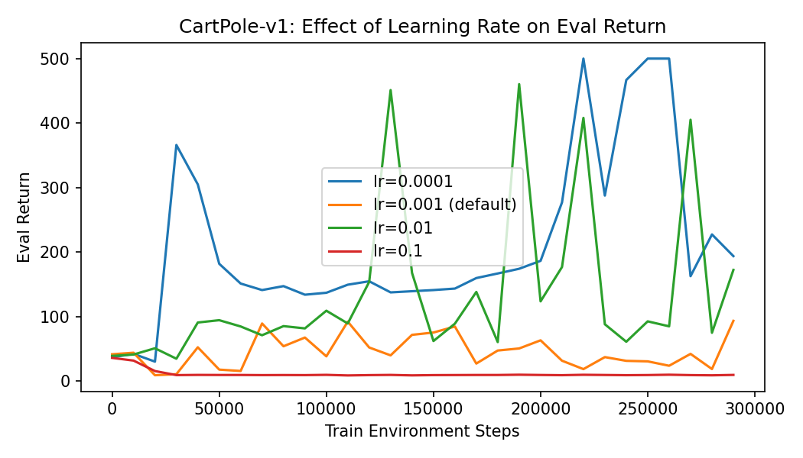
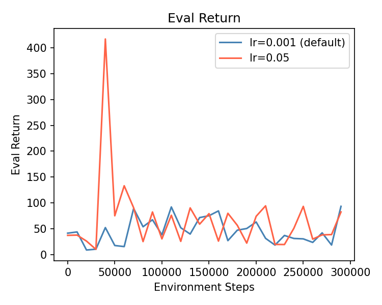
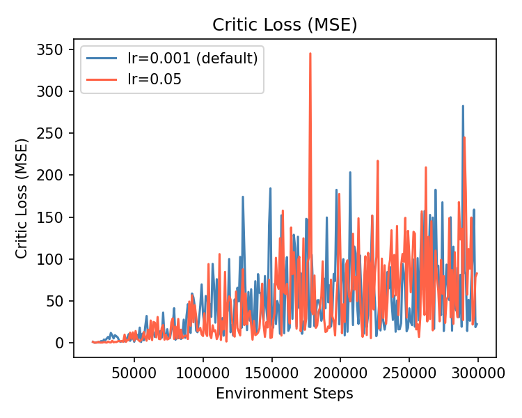
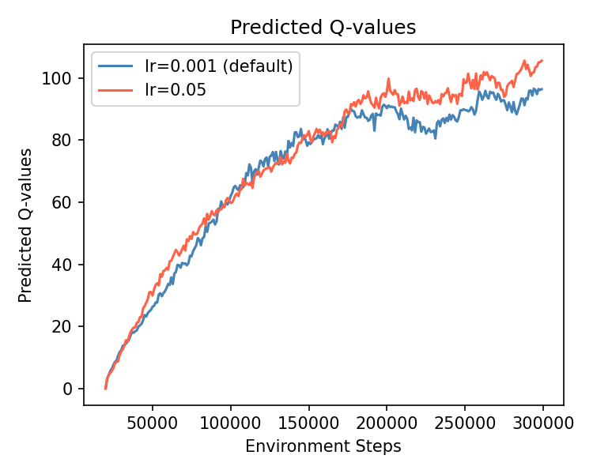
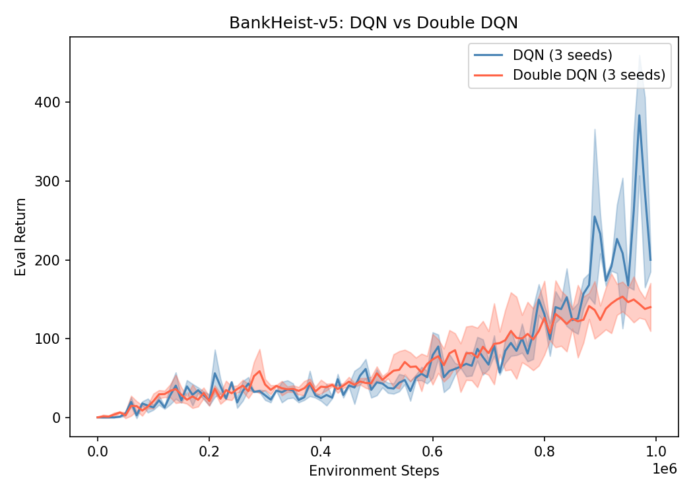

# HW3: Deep Q-Networks (DQN and Double DQN)

**Course:** CAS4160 — Reinforcement Learning (Yonsei University)  
**Environments:** CartPole-v1 · BankHeist-v5 (Atari)

---

## Overview

This homework implements **DQN** and **Double DQN (DDQN)** for discrete action spaces.

| Algorithm | Description |
|---|---|
| **DQN** | Deep Q-Network with experience replay and target network |
| **DDQN** | Double DQN — decouple action selection from evaluation to reduce overestimation |

Key components:
- **Experience replay buffer:** Breaks temporal correlations in training data
- **Target network:** Stabilizes TD targets (updated every `target_update_period` steps)
- **ε-greedy exploration:** Annealed from 1.0 → 0.02

**Double DQN fix:**  
Standard DQN uses the same network to select and evaluate the next action, leading to overestimation.  
DDQN selects the action with the online network but evaluates it with the target network:

```
a* = argmax_a Q(s', a; θ)          # online network selects
y = r + γ · Q(s', a*; θ-)          # target network evaluates
```

---

## Results

### CartPole-v1

DQN training curve:



Learning rate comparison:



Evaluation return across LR settings:



Critic loss:



Q-value estimates:



---

### BankHeist-v5 (Atari) — DQN vs DDQN

DDQN reduces Q-value overestimation and improves final performance:



---

## Project Structure

```
hw3/
├── cas4160/
│   ├── agents/
│   │   └── dqn_agent.py         # DQNAgent: critic, target, update
│   ├── infrastructure/
│   │   ├── replay_buffer.py     # ReplayBuffer + MemoryEfficientReplayBuffer (Atari)
│   │   └── dqn_utils.py         # Env wrappers, schedules
│   ├── env_configs/
│   │   ├── dqn_basic_config.py  # CartPole/LunarLander configs
│   │   └── dqn_atari_config.py  # Atari configs (frame stacking, preprocessing)
│   └── scripts/
│       └── run_hw3.py           # Entry point
├── experiments/dqn/             # YAML experiment configs
├── images/                      # Result plots
├── latex/                       # Report (LaTeX source)
├── requirements.txt
└── setup.py
```

---

## Setup

### Option 1: Docker

```bash
docker pull jellyho/cas4160:0307
```

### Option 2: Conda

```bash
conda create -n cas4160 python=3.10 -y
conda activate cas4160
conda install -c conda-forge swig=4.0.2
pip install -r requirements.txt
pip install -e .
```

---

## Running Experiments

```bash
# CartPole DQN
cd cas4160/scripts
python run_hw3.py -cfg ../../experiments/dqn/cartpole.yaml --seed 1

# BankHeist DQN
python run_hw3.py -cfg ../../experiments/dqn/bankheist.yaml --seed 1

# BankHeist DDQN
python run_hw3.py -cfg ../../experiments/dqn/bankheist_ddqn.yaml --seed 1
```

### Visualize

```bash
tensorboard --logdir data
```

---

## Key Findings

- DQN successfully solves CartPole-v1 with proper learning rate tuning.
- The learning rate has a significant impact — too high causes instability; too low is slow to converge.
- On BankHeist, **DDQN outperforms DQN** by reducing Q-value overestimation, leading to more accurate value estimates and better policies.
